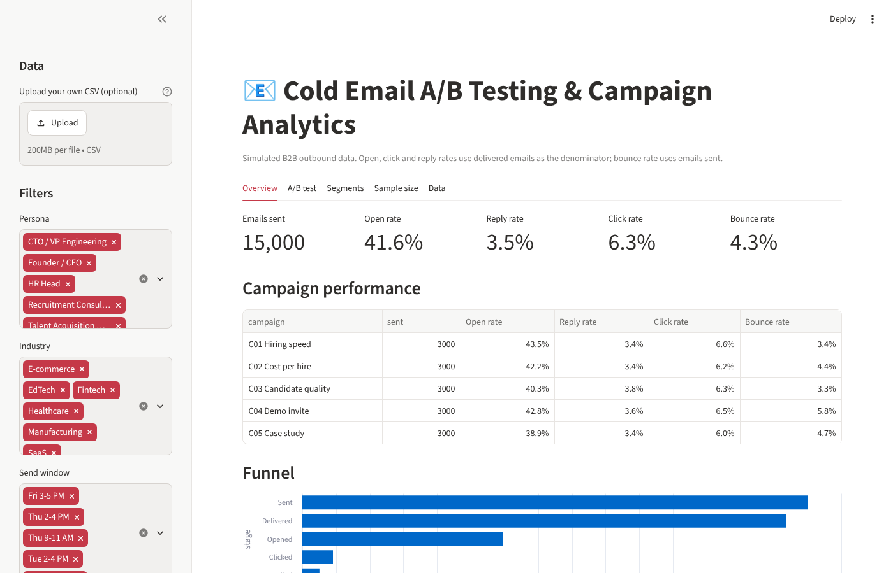
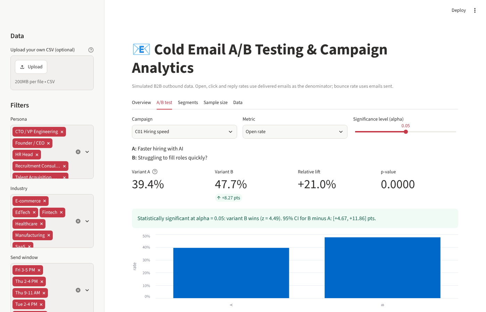

# Cold Email A/B Testing & Campaign Analytics Dashboard

An interactive Streamlit dashboard for analysing B2B cold-email campaigns: it tracks open, click, reply and bounce rates, and runs **two-proportion z-tests** to decide whether subject line B really beats subject line A. Built around the questions an outbound growth team asks every week.

> **Data note:** the bundled dataset is **simulated** (15,000 emails, 5 campaigns, 2 subject-line variants each) with known effects planted in it, so the statistics can be checked against ground truth. You can upload your own campaign export instead (see below).




## What it does

| Tab | What you get |
|---|---|
| **Overview** | KPIs, per-campaign table, send-to-reply funnel |
| **A/B test** | Pick a campaign and metric; get rates for A and B, relative lift, z-score, p-value, 95% confidence interval and a plain-English verdict. A table tests every campaign at once, with a Bonferroni-adjusted column |
| **Segments** | Rates by persona, industry and send window, plus a persona x send-window open-rate heatmap |
| **Sample size** | How many emails per variant you need to detect a given lift (power analysis) |
| **Data** | Filtered rows and CSV download |

Sidebar filters (persona, industry, send window) apply everywhere.

## Metric definitions

- **Open / click / reply rate** = events / *delivered* emails (bounced emails excluded)
- **Bounce rate** = bounced / *sent*

## Statistical method

For variants A (control) and B with successes x and trials n:

- Test statistic: `z = (p_B - p_A) / sqrt(p(1-p)(1/n_A + 1/n_B))`, with pooled `p = (x_A + x_B)/(n_A + n_B)`; two-sided p-value from the normal distribution.
- Confidence interval for `p_B - p_A` uses the unpooled standard error.
- Because several campaigns are tested together, the dashboard also shows a **Bonferroni**-corrected verdict (alpha / number of campaigns) to limit false positives.
- Sample size per arm: `n = (z_(a/2) * sqrt(2 p̄ (1-p̄)) + z_b * sqrt(p1(1-p1) + p2(1-p2)))^2 / (p2-p1)^2`.
- The z-test is verified in `tests/` against SciPy's uncorrected chi-square test (the two are mathematically equivalent for a 2x2 table).

## Sample findings (simulated data, open rate)

| Campaign | A | B | Lift | p-value | Significant (Bonferroni) |
|---|---|---|---|---|---|
| C01 Hiring speed | 39.4% | 47.7% | +21.0% | <0.0001 | Yes |
| C02 Cost per hire | 42.0% | 42.5% | +1.1% | 0.80 | No |
| C03 Candidate quality | 34.3% | 46.3% | +35.1% | <0.0001 | Yes |
| C04 Demo invite | 41.4% | 44.3% | +7.1% | 0.12 | No |
| C05 Case study | 40.6% | 37.2% | -8.4% | 0.06 | No |

Question-style subject lines won in 2 of 5 campaigns, and the other three could not be separated from noise. C04's +2.9 pt gap would need roughly 4,500 emails per variant to confirm. The Sample size tab shows this.

## Run it

```bash
git clone https://github.com/YOUR-USERNAME/email-ab-testing-dashboard.git
cd email-ab-testing-dashboard
python -m venv .venv && source .venv/bin/activate   # Windows: .venv\Scripts\activate
pip install -r requirements.txt
python -m src.generate_data        # optional: regenerate data/campaigns.csv
streamlit run app.py
pytest                             # run the tests
```

## Use your own data

Upload a CSV in the sidebar with these columns: `campaign, variant (A/B), persona, industry, send_window, sent, bounced, opened, clicked, replied` (one row per email; the last four are 0/1). An optional `subject_line` column is shown in the A/B tab.

## Project structure

```
app.py                  Streamlit dashboard
src/analysis.py         rates, z-test, CI, Bonferroni, sample-size maths
src/generate_data.py    reproducible campaign simulator (seeded)
tests/test_analysis.py  unit tests (z-test vs SciPy, data integrity, planted effects)
data/campaigns.csv      generated dataset
```

## Possible extensions

Sequential testing / peeking correction, Bayesian A/B comparison, multi-variant (A/B/n) tests, connecting to a Smartlead or Apollo export.

## Tech

Python, Pandas, NumPy, SciPy, Streamlit, Altair, pytest.
